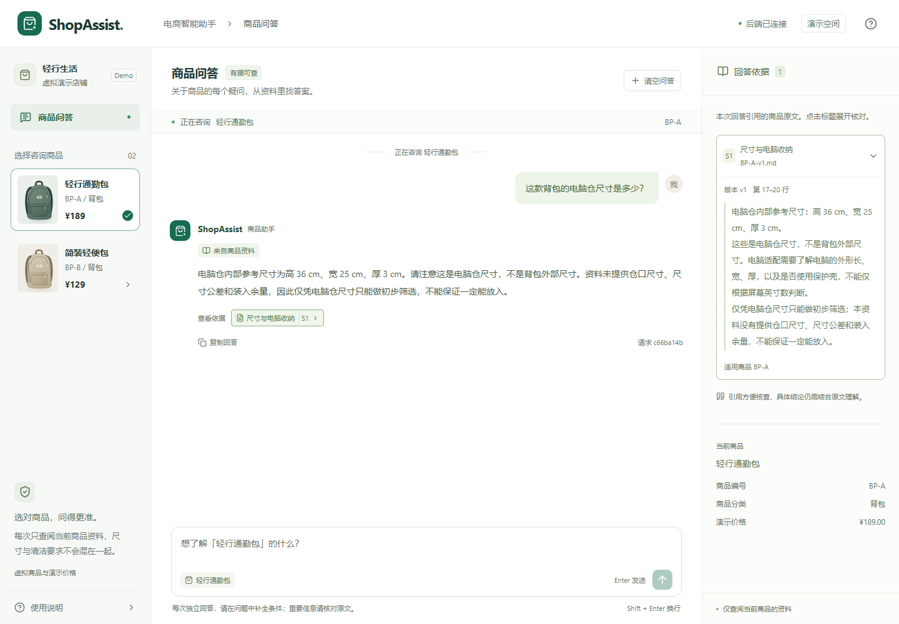
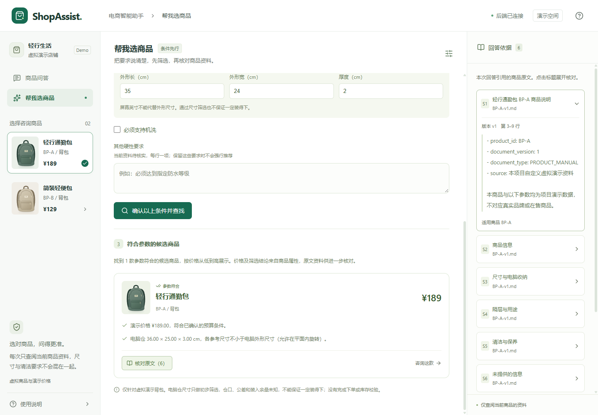

# ShopAssist

商品知识问答与条件推荐：先确认需求，再核对证据。

个人实践项目，使用两款虚拟背包验证电商场景下的 RAG 与受控推荐流程。当前已实现带引用问答、商品条件筛选和可演示页面；售后工单与完整 Agent 编排仍在规划中。



## 已实现

- **知识入库**：UTF-8 Markdown 解析、按标题和长度分块、异步任务状态、内容哈希校验、版本管理。
- **向量检索**：Ollama BGE-M3 1024 维向量，PostgreSQL/pgvector 余弦检索；按商品 ID、有效版本和向量空间过滤。
- **带引用问答**：DeepSeek 根据检索片段回答，返回文档、版本、标题、行号与原文；校验引用 ID，不伪装模型错误为资料不足。
- **条件推荐**：自然语言识别后由用户核对，Java 参数化 SQL 按预算、电脑外形尺寸和机洗要求筛选；缺信息追问、无符合商品不放宽约束、无法核实的硬性要求不忽略。
- **问答页面**：商品切换、快捷提问、原文面板、错误重试、独立商品记录与手机布局。

推荐筛选使用商品结构化属性，说明原文按商品及生效版本读取；不依赖向量相似度决定商品是否合格。电脑仓尺寸只用于初步筛选，不保证一定能装入。



## 技术栈

| 层次 | 实现 |
| --- | --- |
| 后端 | Java 21、Spring Boot 3.5.16、Spring JDBC、Flyway |
| 数据 | PostgreSQL 17、pgvector 0.8.2 |
| 模型 | Ollama bge-m3:567m（1024 维）、DeepSeek deepseek-flash |
| 页面 | React、TypeScript、Vite、lucide-react |
| 验证 | JUnit、Mockito、MockMvc、PowerShell 固定用例、真实接口联调 |
| 环境 | Docker Compose，Maven Wrapper，npm lockfile |

## 本地启动

需要 JDK 21、Node 22.12+、Docker Desktop / Docker Compose。第一次启动需要联网下载镜像和约 1.2 GB 的向量模型。聊天与需求识别需要你自己的 DeepSeek 官网 API Key；本地向量模型无需云端 Key。

### 1. 准备数据库与本地向量模型

在仓库根目录执行：

```sh
docker compose up -d --wait postgres ollama
docker compose run --rm model-init
```

Windows 也可以运行 `./scripts/start-local.ps1`。默认仅绑定本机，数据库端口 55432、Ollama 端口 11434。

### 2. 运行 Java

IDEA 打开 server/pom.xml，选择 JDK 21，在 DemoApplication 运行配置的环境变量中设置 DEEPSEEK_API_KEY，运行 DemoApplication。后端默认 http://127.0.0.1:8081 。

也可在已配置环境变量的终端中运行：

```sh
cd server
./mvnw spring-boot:run
# Windows 使用 .\mvnw.cmd spring-boot:run
```

Java 不会自动读取根目录 .env；IDEA 或终端需要单独配置环境变量。Key 不放入前端或仓库。默认数据库口令仅用于本地演示，覆盖配置见 [.env.example](.env.example)。

### 3. 入库演示资料

Windows PowerShell 在根目录执行：

```powershell
.\scripts\check-retrieval.ps1 -RetryFailed
```

该脚本上传 data/demo/documents/ 下两份 Markdown，等待解析，创建向量索引并验证商品范围检索。其他环境可根据[入库接口文档](docs/06-Markdown入库与验收.md)调用接口。

### 4. 运行页面

```sh
cd web
npm ci
npm run dev
```

打开 http://127.0.0.1:5173 。在“商品问答”咨询指定商品，或在“帮我选商品”识别、确认条件并查找候选商品。

前端开发代理默认指向 8081；覆盖端口见 [web/.env.example](web/.env.example)。后端容器 Dockerfile 和 Compose app profile 已提供，但完整容器应用启动尚未验收；以上主要验证方式为 IDEA 后端 + 容器依赖 + 独立前端。

## 验证

```powershell
# server/：默认自动测试，不需要付费模型接口
.\mvnw.cmd test

# web/：类型检查与打包
npm run build

# 仓库根目录：已运行服务的固定用例
.\scripts\check-qa.ps1
.\scripts\check-recommendations.ps1
# 可选：增加一次真实需求识别调用
.\scripts\check-recommendations.ps1 -IncludeModel
```

- 默认 Java 测试：35 条通过，5 条数据库集成用例按开关跳过。
- 独立 PostgreSQL 推荐集成测试：4 条通过，覆盖预算边界、尺寸旋转、未知属性、参数错误、引用商品与生效版本。
- 真实问答：7 个固定用例通过；推荐：8 个条件用例及 1 个真实需求识别用例通过。
- 这些是固定场景验证，不代表整体准确率、召回率、幻觉率或性能提升结论。真实问答及自然语言识别会产生 API 调用费用。

## 目录

```text
server/       Java 模块化单体：入库、模型、检索、问答、推荐
web/          React 商品问答与条件推荐
infra/        数据库初始化
scripts/      启动与接口验证
data/demo/    虚拟商品及说明资料
docs/         架构、接口、阶段验收与排错记录
evaluation/   Python 评测规划，尚未实现
```

- [架构与目录](docs/03-整体架构与目录约定.md)
- [模型与启动配置](docs/10-DeepSeek与本地模型部署.md)
- [真实问答验收](docs/11-首次真实问答验收.md)
- [前端运行与边界](web/README.md)
- [条件推荐设计与验收](docs/13-条件推荐与验收.md)

## 当前边界

当前为本地单用户演示，数据均为虚拟资料。页面历史仅存于内存，不等于后端多轮记忆或用户隔离。尚未实现混合检索、Rerank、正式效果评测、长期记忆、MCP、Skills、LangGraph、售后工单、支付或退款。

源码与架构学习参考 [Ragent](https://github.com/nageoffer/ragent)，固定参考提交记录于[环境核对](docs/01-环境核对.md)。本仓库为独立精简实现，未宣称参考项目的能力均已完成。历史文档中的计划和阶段记录不作为当前功能完成证明。