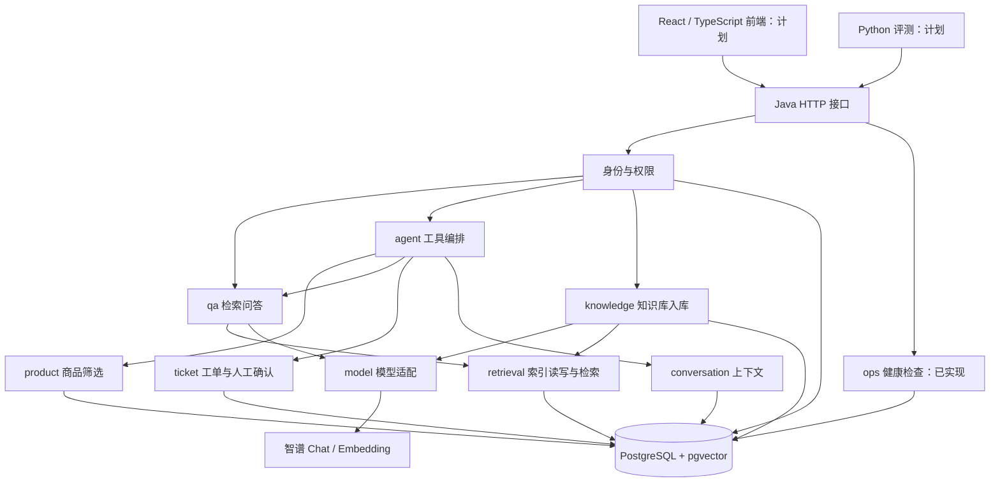

# ShopAssist：整体架构与目录约定

当前实现更新：主线已改为 Ollama BGE-M3 向量化 + DeepSeek 回答，已增加 /api/qa、模型自动初始化、后端 Dockerfile 和 Compose app profile。具体配置及本轮未验证项以 [当前部署文档](10-DeepSeek与本地模型部署.md) 为准；下文历史模型选型与阶段状态用于说明演进，不能作为当前完整运行证明。

2026-11-02 更新：web/ 已实现 React 商品问答页面，见 [页面验收](12-商品问答页面验收.md)。下文的“前端计划”等标记描述早期阶段。

更新日期：2026-11-01。本文是当前代码目录与后续模块落点的依据；原项目设计文档保留业务背景和完整需求。本轮只完成框架整理，具体状态见最后一节。

## 1. 工程形态

一个 Spring Boot 后端、一个 PostgreSQL 数据库；前端和 Python 评测分别放置。后端采用按业务分包的模块化单体，各业务在同一个进程中通过 Java 方法协作，无需相互发送 HTTP 请求。HTTP 是前端、Python 与后端之间的边界。



图中商品只读查询、Markdown 入库、Embedding 适配及向量检索已实现；真实模型调用待配置密钥验证。聊天生成、身份校验及 Agent 属计划。当前为本地单用户开发入口。原文暂存数据库 source_text，后续支持大文件再增加文件存储。

## 2. 当前目录

```text
program_two/
├─ server/                     Java 后端，一个 Maven 工程
│  ├─ pom.xml
│  ├─ mvnw / mvnw.cmd / .mvn/  固定构建工具
│  └─ src/
│     ├─ main/java/com/luhao/ecommerce/
│     │  ├─ DemoApplication.java
│     │  ├─ ops/
│     │  │  ├─ api/HealthController.java
│     │  │  └─ application/HealthService.java
│     │  ├─ product/           商品属性与条件筛选
│     │  ├─ knowledge/         文档解析、分块、版本、入库任务
│     │  ├─ retrieval/         向量索引、过滤、检索证据
│     │  ├─ qa/                检索与生成、引用检查
│     │  ├─ model/             Chat / Embedding 供应商适配
│     │  ├─ agent/             工具选择、执行循环、异常恢复
│     │  ├─ conversation/      多轮上下文及对话持久化
│     │  ├─ identity/          登录身份与权限
│     │  └─ ticket/            工单确认、幂等与状态
│     ├─ main/resources/application.yaml
│     └─ test/java/…/ops/api/HealthControllerTest.java
├─ web/                        前端规划入口，尚无 npm 工程
├─ evaluation/                 Python 评测规划入口
├─ data/demo/                  演示商品与资料规划入口
├─ infra/init.sql              空数据库首次初始化：启用 vector
├─ scripts/check-health.ps1    健康检查脚本
├─ docs/                       环境、验收、架构记录
├─ compose.yaml                本地数据库与持久化卷
├─ .env.example                配置样例，无真实密钥
└─ README.md                   启动与阅读入口
```

product、knowledge、model 和 retrieval 已有实现，ops 提供健康检查；其余计划业务包仅含职责说明。shared/error 提供跨模块错误响应。运行日志、测试临时文件放 .runtime/；构建产物放 server/target/；均忽略提交。已有学习计划与简历材料暂留原位置。

## 3. 后端内部约定

各业务实现时按需要建立以下子包；目录随实际代码创建，不先生成空 Controller、空实现或假数据成功接口。

| 子包 | 职责 | 示例 |
| --- | --- | --- |
| api | HTTP 参数与响应、调用应用服务 | ProductController、QaRequest |
| application | 用例流程、事务边界、对外服务方法 | SearchProductsService、IngestDocumentService |
| domain | 业务对象、状态与规则 | Product、DocumentVersion、Ticket |
| infrastructure | JDBC、文件存储、外部协议具体实现 | JdbcProductRepository |

业务包间只调用 application 中明确公开的服务或能力接口，不跨包操作别人的表或 Controller。api 不承载检索流程，repository 不决定用户授权规则。简单只读查询可直接在 application 使用 JdbcTemplate，只有出现复用或替换需要时再抽持久化接口；当前健康检查即采用此简化方式。

具体依赖方向：

- knowledge → model、retrieval；负责写入资料，不调用 qa 生成问答。
- qa → product、retrieval、model；负责指定商品的证据问答。
- agent → product、qa、ticket、conversation；工具封装调用这些服务，不复制业务规则。
- retrieval → model（问题向量化）、PostgreSQL；检索方法接收明确商品与有效范围，返回证据，不生成最终答案。
- identity 为受保护入口提供身份；conversation、ticket 在应用服务检查归属，不能仅靠页面隐藏数据。
- model 只负责供应商协议，不依赖商品、工单、Agent。已在 model/application 定义 EmbeddingClient，在 model/infrastructure/bigmodel 提供实现；ChatClient 尚未实现。

不引入微服务、MQ 或第二套主编排框架。shared 目前仅包含商品和知识库共同使用的错误响应，不作为任意业务逻辑的归宿。

## 4. 三条核心业务链路

### 指定商品问答：首个 demo

1. 管理员上传 Markdown，knowledge 校验并记录原文件、版本和持久化任务。
2. 按标题/长度分块，调用 Embedding，保存关联明确商品和文档版本的片段及向量。
3. 用户提交 productId 和问题，qa 先检查商品是否存在。
4. retrieval 将问题向量化，在商品和有效版本范围内查询证据。
5. qa 将证据交给 ChatClient，核对引用编号后返回答案、引用和 requestId。

未知商品、无证据、资料冲突与供应商失败需要分别表达。文档入库没有成功前不显示 READY；本轮框架整理未实现此链路。

### 条件推荐：第二个闭环

agent 提取预算/类别/尺寸 → 必要时追问 → product 用代码筛选硬条件 → qa/retrieval 补充候选说明 → 返回最多 2～3 款和推荐依据。
无候选时询问是否调整条件；属性缺失不能判定为满足要求。首版不训练推荐模型。

### 售后咨询工单：后续闭环

收集问题 → 可编辑草稿 → 绑定用户、会话和参数的确认 → ticket 幂等写入 → 返回工单编号。写入超时结果未知时先按幂等键查询；未确认不得创建。只查询本人可见工单。

## 5. API、数据归属与运行约定

| 状态 | 接口 | 所属模块 |
| --- | --- | --- |
| 已实现 | GET /api/health | ops |
| 已实现 | POST /api/admin/documents | knowledge |
| 已实现 | GET /api/admin/ingestion-jobs/{id}、GET /api/admin/ingestion-jobs/{id}/chunks | knowledge |
| 计划 | POST /api/qa | qa |
| 已实现 | GET /api/products、GET /api/products/{id} | product |
| 已实现 | POST /api/admin/ingestion-jobs/{id}/index、POST /api/retrieval/search | retrieval |
| 计划 | POST /api/conversations/{id}/messages | agent、conversation |
| 计划 | POST /api/confirmations/{id}/confirm、GET /api/tickets/{id} | ticket |

原设计文档中的 /api/qa 为首个 demo 独立入口；后续对话接口复用同一问答服务。以上计划接口尚不可调用，不返回占位成功。

数据归属：product 管理 products；knowledge 管理 documents、document_versions、chunks 原文与 ingestion_jobs；retrieval 管理 chunk_vectors，以上已用 Flyway 创建。conversation 的 conversations/messages、ticket 的 confirmations/tickets/ticket_events、identity 的 users 仍待后续迁移实现。

原设计要求的商品/版本过滤、用户归属、确认参数绑定、幂等约束保持有效。检索允许的商品范围由应用服务给定，不能由文档指令扩大。

后续业务 DDL 使用版本化迁移，不将增量建表持续堆入仅空卷执行的 infra/init.sql；引入迁移工具时单独验收已有数据库升级路径。

无密钥时可启动和解析文档；向量化/检索调用 embedding-3（1024 维），由 BIGMODEL_API_KEY 配置，真实调用待验证。glm-5.3-flash 尚未接入；详见 07-向量入库与检索.md。

## 6. 当前状态与验收

- 已实现：ops、商品只读接口、持久化后台任务、Markdown 上传与分块结果查询；具体限制和验收见 06-Markdown入库与验收.md。
- 已实现并新增回归覆盖：正常返回 200、缺扩展返回 503、数据库异常返回 503 且不泄露异常详情。
- 先前已真实验证：数据库健康、停库 503、恢复 200。
- 已准备：两款演示商品 CSV 与 Markdown 说明，核对记录见 05-演示资料验收.md；尚未导入数据库。
- 计划：其他业务包、前端、Python 评测与模型适配；目录存在不代表功能完成。

已实现 Markdown 至 READY 的代码链路与指定商品检索，并通过模型替身的真实数据库测试；接下来本机验证真实 Embedding，再接带引用回答。推荐和工单随后扩展。
