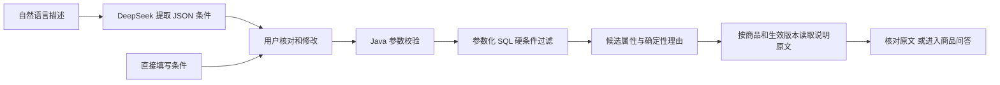

# 条件推荐：设计与验收

日期：2026-11-02。范围为两款虚拟背包的参数候选筛选，不是个性化推荐算法、购物交易或完整 Agent。

## 执行流程



模型只提取条件，不生成 SQL，不决定不满足条件的商品能否入选。候选解释来自商品属性，原文来自已生效的知识文档；用户需要进一步咨询时进入原有 RAG 问答。推荐读取原文按 ID 精确查询，本轮没有把相似度检索当作硬条件筛选。

## 支持与限制

- 预算下限/上限及是否包含边界，例如“不超过129”和“低于129”不同。
- 电脑含保护壳的外形长、宽、厚。长宽可以在平面内旋转，厚度单独判断；仅知道屏幕英寸时追问，缺少完整尺寸不推荐。
- 必须机洗。V4 为商品增加 nullable machine_washable；两款演示说明均禁止机洗，因此均设 false。未来商品属性未知为 NULL，不能当作支持。
- 防水等级、承重、颜色等未覆盖的硬条件保留到 unsupportedRequirements；返回 INSUFFICIENT，不静默忽略。
- 未给出任何可筛选条件返回 NEED_INFO；无符合商品返回 NO_MATCH，不自动放宽条件。
- 结果按价格升序、商品 ID 次序排列，最多 10 款。参数符合仅代表初步候选，仓口、公差、装入余量未知，不保证电脑一定能装入。

商品属性与文档清洁要求保持人工核对的一致性；本轮尚未实现从文档自动更新结构化商品属性或二者变更冲突检测。

## 接口

`POST /api/recommendations/understand`

```json
{"message":"预算不到150元，必须放14寸电脑，推荐背包"}
```

返回 criteria、requestId 和核对提示。该例应识别 maxPriceCny=150、maxPriceInclusive=false、needsLaptop=true、laptop=null。不能从14寸猜测机身尺寸。错误模型格式为 REQUIREMENT_INVALID，模型调用故障保留 CHAT_* 服务错误；用户仍可直接填写条件。

`POST /api/recommendations`

```json
{
  "maxPriceCny":200,
  "needsLaptop":true,
  "laptop":{"lengthCm":35,"widthCm":24,"thicknessCm":2},
  "machineWashRequired":false,
  "unsupportedRequirements":[]
}
```

返回 status、criteria、message、candidates、notice、requestId。候选包含 product、reasons、citations、evidenceStatus。引用带商品、文档、版本、标题、行号与原文；缺少有效文档时明确 MISSING，不能伪造引用。该例只有 BP-A 入选。

## 代码位置

- recommendation/domain/RecommendationCriteria：范围、精度、预算矛盾、完整尺寸校验。
- recommendation/application/RequirementService：模型需求识别、严格 JSON 类型和字段校验。
- recommendation/application/RecommendationService：缺条件、未知要求、候选理由与返回状态。
- recommendation/infrastructure/RecommendationRepository：参数化筛选与生效原文查询。
- db/migration/V4__recommendation_attributes.sql：机洗结构化属性，与 CSV 同步固定演示值。
- web/src/components/RecommendationPanel.tsx：描述、核对、筛选、候选与原文入口。

## 已验证

- 默认 Maven 全量测试：35 条通过，5 条数据库集成用例按开关跳过，无失败。
- 单独启用真实 PostgreSQL 推荐集成测试：4 条通过，覆盖预算边界、旋转尺寸、机洗未知值、下架商品、参数错误、引用只来自候选商品及生效版本。使用专用 ecommerce_rag_recommendation_test 数据库，测试数据事务回滚，不证明模型质量。
- 真实服务固定用例：预算150仅B、129含边界有B、129不含边界无结果、预算200+35×24×2仅A、预算150+相同电脑无结果、缺电脑尺寸追问、必须机洗无结果、要求IPX7资料不足，共8例通过。
- 真实模型需求识别：不到150+14寸电脑，正确保留严格预算边界并缺尺寸追问，1例通过；该单例不代表提取准确率。
- 实际浏览器：从自然语言识别200元+35×24×2，到用户确认，再展示A候选与6个本商品原文片段，流程通过。
- TypeScript 检查和 Vite 打包通过。

复验（需要后端已运行；-IncludeModel 额外产生一次聊天 API 调用）：

```powershell
.\scripts\check-recommendations.ps1 -IncludeModel
```

请求与结果保存在 .runtime/recommendation-results.json，未提交 Git。

运行推荐数据库集成测试前先创建同名专用测试数据库，再在 server/ 执行：

```powershell
$env:DEMO_INTEGRATION_TESTS='true'
.\mvnw.cmd '-Dtest=RecommendationIntegrationTest' test
Remove-Item Env:DEMO_INTEGRATION_TESTS
```

不要在主业务数据库中执行集成测试。旧向量集成测试有独立 DB_URL 要求，不要仅打开开关就在主库运行所有集成用例。

## 复盘题

预算150元、电脑35×24×2 cm时，B价格合适但尺寸不足，A尺寸合适但超预算，应该返回什么？为什么不能挑一个“更相似”的商品推荐？
