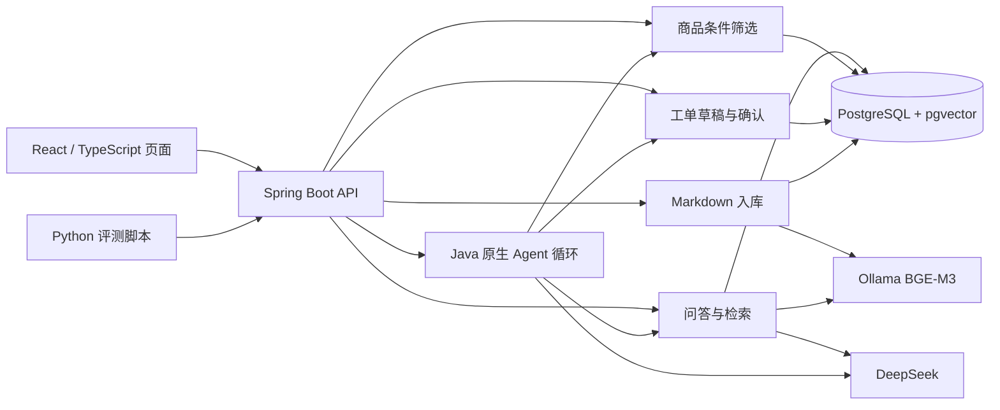

# ShopAssist 项目总体方案与分块计划

更新：2026-11-02。本文根据当前代码与既有验收记录整理，是后续讨论的方案草稿；其中计划和目标不是已实现的功能。旧阶段文档保留历史，状态冲突时先核对本方案、代码和对应验收记录。

## 1. 项目定位

ShopAssist 是面向虚拟电商店铺的商品咨询助手，围绕两款演示背包完成有依据的商品问答、条件筛选推荐和售后咨询登记。面向 Java 后端和 Agent 应用实习实践：重点展示业务规则、RAG、工具调用、受控写入和评测，学习投入优先服务项目交付。

角色：顾客在页面咨询；演示管理员准备商品资料并入库。商品均为虚拟数据，当前没有真实商家、真实订单或客服工作人员。本项目只登记咨询，不实际审核订单、支付、退款、退货或赔付。

## 2. 功能和业务流程

| 功能 | 流程 | 关键规则 |
| --- | --- | --- |
| 商品问答 | 选择商品 → 输入问题 → 商品范围检索 → 模型基于片段回答 → 展示引用 | 商品 ID 和有效版本过滤；引用展示原文；资料不足说明无法确认；接口故障单独报错。 |
| 条件推荐 | 点选预算和需求（也可选文字提取）→ 核对条件 → 结构化属性过滤 → 返回候选 | 硬条件不能只凭向量相似度判断；资料不全或缺关键尺寸时说明或追问；电脑仓尺寸不保证实际适配。 |
| 售后咨询 | 进入售后服务 → 选择商品、填写问题 → 生成草稿 → 可修改、取消 → 勾选确认 → 创建工单 | 草稿不等于正式工单；同一草稿确认重试返回原工单；不同草稿允许各自创建；不等于已批准退款。 |
| Agent | 用户允许自动选工具 → 模型给出调用 → Java 校验参数并执行 → 结果回传 → 返回回答或可核对草稿 | 原生工具循环最多 3 次；工具错误明确返回；正式工单创建只允许用户确认入口，不交给模型。 |
| 知识入库 | 提交 Markdown 和商品 ID → 解析分块 → 任务排队 → Embedding → 向量与版本入库 → 激活版本 | 未成功不标为 READY；商品和文档版本绑定；更新切换成功前保留旧版。删除与完整权限尚待设计实现。 |

## 3. 当前架构与技术选型

| 层次 | 当前选择 | 目的和限制 |
| --- | --- | --- |
| 后端 | Java 21、Spring Boot、Spring JDBC、Flyway | 一个模块化单体，分商品、知识库、检索、问答、Agent、工单等包；不为练框架拆微服务。 |
| 数据 | PostgreSQL 17、pgvector 0.8.2 | 商品属性、资料、片段、向量、草稿和工单；当前为本地演示。 |
| 检索 | 标题及长度分块、Ollama `bge-m3:567m` 1024 维、商品过滤、精确余弦 Top-K | 当前纯向量基线；混合检索与 Rerank 尚未实现，后续依据评测和成本选择。 |
| 生成 | DeepSeek Chat | 依据召回证据作答；引用编号校验不能保证结论真实。需要用户自行配置密钥，会产生调用费用。 |
| 编排 | Java 原生工具调用循环 | 已运行的最小 Agent；LangGraph 尚未接入，后续用于 Python 小链路实践，不重写整个项目。 |
| 前端 | React、TypeScript、Vite | 问答、点选推荐、售后入口；当前会话及工单页面状态在内存，刷新后无法找回。 |
| 评测 | Python 标准库、JSONL、人工核对 | 有初步固定检查；正式评测与对照计划见 [评测方案](19-RAG评测与优化方案.md)。 |
| 环境与交付 | Docker Compose、Maven Wrapper、npm | 已验证 IDEA 后端连接容器数据库及本地 Ollama；完整容器应用和新电脑克隆启动尚需专项验证。 |

## 4. 现状：实现、验证、缺口

| 模块 | 已实现 | 已验证 | 尚需完成 |
| --- | --- | --- | --- |
| 入库与检索 | Markdown 解析分块、向量化、索引和版本切换、按商品过滤 | 本地真实模型和数据库链路、固定检索题；具体见 [向量检索记录](07-向量入库与检索.md) 及 [真实问答记录](11-首次真实问答验收.md) | 删除、正式评测、对照优化；数据隔离和管理权限。 |
| 问答 | 基于证据生成、引用与错误处理 | 固定问题人工核对、手洗边界两次小样本对照 | 更多问题、引用支持度和失败分析；一次 504 原因未定位。 |
| 推荐 | 条件点选、可选需求识别、Java 结构化硬条件过滤 | 固定推荐用例与页面联调 | 扩大商品和属性覆盖后再评估效果。 |
| Agent | 原生工具调用、参数检查、次数上限、工单仅草稿 | 固定真实工具调用及页面联调 | 更系统的异常恢复、上下文与记忆；MCP/Skills 尚未实现。 |
| 工单 | 草稿、修改/取消、人工确认、幂等写入、直接售后入口 | 真实数据库并发测试和真实页面联调 | 工单查询、刷新恢复、认证及用户归属；没有客服后台。 |
| 工程 | API、Flyway、健康检查、日志、页面、本地依赖启动 | 既有测试和本机链路；GitHub CI 以实际运行状态为准 | 完整容器/新电脑部署、权限、系统评测、端到端成本统计。 |

各阶段的具体证据以 README 链接的验收记录为准，历史记录反映当时状态，不应直接视为当前所有功能的验证。

## 5. 主要边界与故障处理

- **商品和知识**：指定商品 ID 与有效版本过滤，禁止拿另一商品的资料回答；资料未写不承诺。文档可能过时或存在歧义，需管理员维护。
- **模型和工具**：检索证据存在不代表生成结果正确；超时或上游 5xx 不能包装为资料不足。工具输入必须校验，限制次数；是否重试由错误类型和操作语义决定。
- **工单**：用户明确确认才创建正式工单，草稿确认令牌只约束草稿，不是登录认证。结果未知时保留同一草稿与幂等键重试；当前不能跨刷新恢复。
- **安全与数据**：当前本机单用户，管理接口和工单未接入身份、授权和用户隔离，不可对公网开放作为真实业务；密钥使用环境变量，不提交仓库或前端。此前曾在聊天中粘贴过密钥，应在供应商平台吊销并更换，避免继续使用该密钥。
- **评测与耗时**：不编造结果，分开报告失败、未评判和成功；质量口径详见评测方案。没有可靠计费数据时只报告调用次数，不估算费用。

## 6. 分块开发与验收顺序

每块开始前确认具体接口、数据、边界和验收方法；复杂部分先讲解并取得用户确认，再开发。每块按“讲解 → 动手 → 验证 → 复盘”完成。预计一天完成一块只是节奏建议，按实际复杂度和投递安排调整，不虚报耗时。

| 顺序 | 模块 / 业务 | 具体实现和练习 | 退出条件 |
| --- | --- | --- | --- |
| 0 | 已有链路复盘 | 理解商品 ID 过滤、工单确认与幂等，能本机运行 | 能说明已有功能、原理和缺口；不把使用 AI 写代码说成自己独立完成。 |
| 1 | 固定评测数据 | 人工制定约 20 道开发题及约 10 道保留题，标商品、类型、必要事实和文档版本/行号；先做小样本示例确认 | 每题可追溯原文，资料不足和追问单独标注，测试集不上传知识库。 |
| 2 | Python 检索评测 | 学 JSONL、HTTP、超时、文件写入；实现 Hit@3、证据 Recall@3、商品违规、错误及耗时统计 | 有逐题结果和汇总，公式可手算核对；失败、未标注与分母明确。 |
| 3 | 回答质量与 Badcase | 保存生成结果及引用，人工标正确性、引用支持、拒答和追问；分类失败原因 | 人工标注可回溯、未判定单列；不得把关键词检查当作语义正确率。 |
| 4 | 检索方案对照 | 针对基线失败，先设计一种候选；优先考虑中文关键词 + 向量融合，再判断 Rerank 是否值得 | 固定数据和配置，报告每题变化、分母、失败及耗时；不预设提升或最优。 |
| 5 | 知识库维护 | 设计文档删除/停用、版本和索引一致性，处理删除期间检索和失败恢复 | 更新及删除后的检索可复现，关键事务和权限边界有测试；未完成认证时仍仅限本地。 |
| 6 | 受控身份与上下文 | 根据时间决定最小登录/身份和数据归属实现；有限轮上下文、截断和隔离 | 两用户相互访问被拒绝，越权和跨用户检索有测试；未完成前不得声称隔离。 |
| 7 | Python + LangGraph 补强 | 先补 Python HTTP 和异常处理，再用 LangGraph 实现一条检索与工具执行小链路，复用 Java API | 运行成功、能解释状态流转、工具失败与次数限制；单独说明它和主 Java Agent 的关系。 |
| 8 | MCP / Skills 与机制学习 | 先核对 Learn Claude Code 最新章节；s01/s02/s03 优先，s08 按需，s07/s14 随项目实践 | 第一轮预算 4～6 小时；实现两个工具最小循环并讲清失败处理；MCP/Skills 实践有实际运行记录。 |
| 9 | 交付与面试复盘 | 验证全新环境启动、构建、必要回归、日志和错误提示；整理项目问答 | README 复现、页面演示、证据链和实际限制齐全；简历只写真实完成并能解释的内容。 |

优先完成 1～4 的可交付基线，随后按投递时间动态决定 5～9 的范围。多轮记忆、长期记忆、反思节点、更多模型并非自动必做，只有实际问题、设计和评估价值明确才进入阶段；不会同时堆多个框架。

## 7. 最终交付和验收

- GitHub 仓库可在说明的环境中克隆、配置并运行；演示资料、启动命令、密钥配置和成本前提清晰，新环境验证完成后才标为通过。
- 用户可完成商品问答与查看来源、确认条件后推荐、人工确认创建咨询工单；边界和失败提示可演示。
- 评测集、指标口径、逐题结果和 Badcase 可核对；有一组真实可复现的基线与候选对照后才写优化结论。
- 重要业务有针对性测试，至少覆盖商品范围、未知信息、工具错误、工单重复确认；安全和部署能力按实际验收状态标注。
- 有讲解文档及面试问题：背景、选型、调用链、关键代码、失败处理、实际结果和不足；不将参考项目的功能或 AI 代写的工作冒称个人独立实现。

## 8. 分天及新聊天交接

每完成一块并复盘后，助手在当次回复提醒：明天可新开聊天继续下一块；实际是否进入下一块由用户确认。无法仅凭本文在未来自动发送提醒；如需定时提醒，另行提供具体时间并通过提醒功能设置。

新聊天可粘贴以下交接内容，并让助手先读取当前文件与 Git 状态、核实服务和最新进度：

> 继续 ShopAssist 项目，先读 `docs/20-项目总体方案与分块计划.md` 和相关阶段验收记录。上一块是【填写】，已实现/已验证【填写】，未完成【填写】，下一块是【填写】。按讲解→动手→验证→复盘推进；复杂部分先确认方案，结束时提醒我新开一天聊天。

当前下一块：第 1 块固定评测数据；尚未制作完整 20+10 题，也未开始第 2 块正式指标实现。
